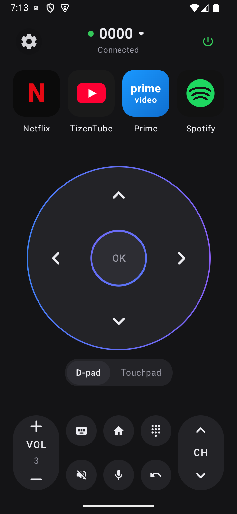
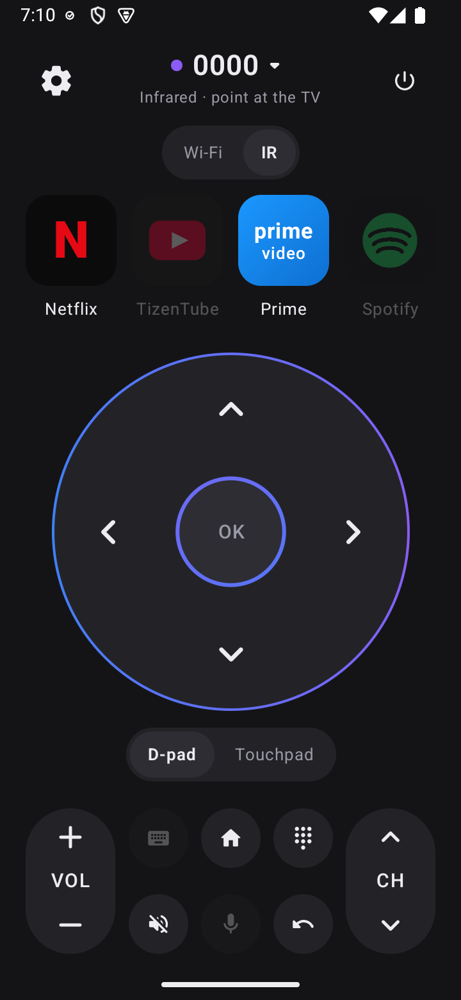
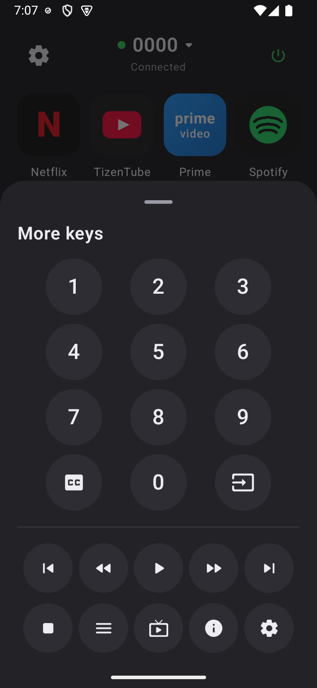
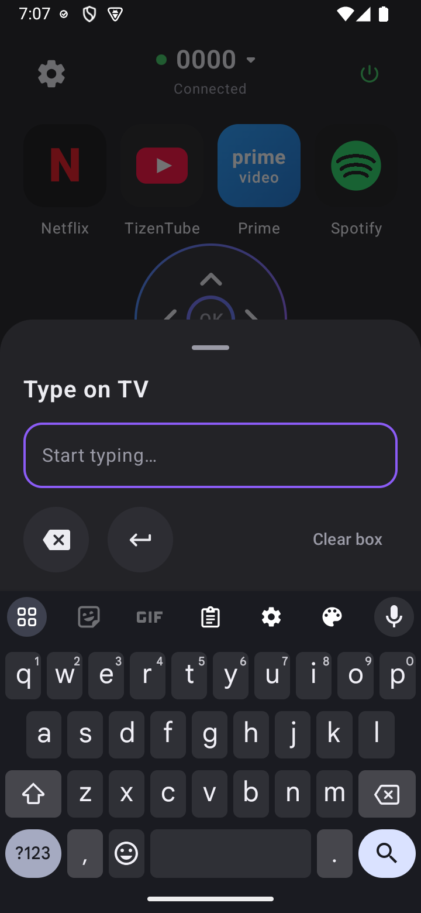

# TV Remote

A fast, lightweight Android remote for Google TV / Android TV, built for a TCL Google TV and a Xiaomi phone. It works two ways:

- **Wi-Fi**: the **Android TV Remote protocol v2**, the same one Google's own remote app uses. TLS on port 6467 for pairing and port 6466 for commands. No ADB, no developer options, no cloud, no ads.
- **Infrared**: through the phone's IR blaster, using TCL's own IR codes. It works with no network and can switch the TV on from deep standby.

The whole app is about 1.5 MB.

<p>
  
  
  
  
</p>

## Download

**[Download TVRemote.apk](https://github.com/sudomastery/tv-remote/releases/latest/download/TVRemote.apk)** (Android 8.0 or newer), or browse all [releases](https://github.com/sudomastery/tv-remote/releases).

To install it, open the APK on your phone and allow installs from that source when asked. Xiaomi phones (HyperOS / MIUI) may run a security scan first.

## Features

| | Wi-Fi | IR |
|---|---|---|
| D-pad with hold-to-repeat, touchpad, OK long-press | yes | yes |
| Volume / channel rockers, mute, home, back, power | yes | yes |
| Number pad, media keys, input, guide, info, captions | yes | yes |
| Live volume level and power state | yes | no |
| Type into TV text fields from the phone keyboard | yes | no |
| Hold-to-talk voice search | yes | no |
| App shortcuts: Netflix, TizenTube, Prime Video, Spotify | all four | Netflix, Prime Video |

When Wi-Fi can't reach the TV, the power button falls back to IR automatically, so it can still turn the TV on.

### App shortcuts

Apps are opened with deep links that each app registers for itself, not `market://launch` links. On this TV the Play Store can't resolve `market://launch`, and the TV's remote service drops the connection when a launch fails.

| Button | Package | Link |
|---|---|---|
| Netflix | `com.netflix.ninja` | `https://www.netflix.com/browse` |
| TizenTube | `io.gh.reisxd.tizentube.cobalt` | `https://www.youtube.com` |
| Prime Video | `com.amazon.amazonvideo.livingroom` | `https://app.primevideo.com` |
| Spotify | `com.spotify.tv.android` | `spotify://` |

The TizenTube button relies on stock YouTube (`com.google.android.youtube.tv`) being uninstalled from the TV. TizenTube is then the only app that handles `youtube.com` links. If stock YouTube is installed, the TV may open it instead. In IR mode the TizenTube button is disabled, because the remote's YouTube IR button targets stock YouTube.

## Project layout

| Module | What it is |
|---|---|
| `atvremote/` | Pure Kotlin/JVM library for the Android TV Remote v2 protocol: pairing, the command channel, a self-signed client certificate (no BouncyCastle), and pinning of the TV certificate |
| `app/` | Jetpack Compose app: UI, mDNS discovery, voice capture, IR transmitter |

### IR codes

`app/src/main/kotlin/.../ir/TclIr.kt` holds the TCL keymap read from the TV itself (`/vendor/tvconfig/config/ir_config.ini`, protocol `0x07`, address `0xF`). Other TCL TVs that use the same RCA-style remote should work too. It is encoded with the same timings as Flipper Zero's RCA encoder. Unit tests check the output bit-for-bit against Flipper-IRDB captures of real TCL remotes.

## Build

Requires JDK 21 and the Android SDK (`local.properties` with `sdk.dir`).

```sh
./gradlew :app:assembleRelease      # build/dist/TVRemote.apk
./gradlew test                      # library and IR encoder tests
```

Release builds are signed with the local debug keystore for sideloading.

### Testing the protocol from a desktop

`atvremote` ships a small CLI for checking things against a real TV without a phone:

```sh
./gradlew -q :atvremote:cli --args="<tv-ip> pair"         # then type the code shown on the TV
./gradlew -q :atvremote:cli --args="<tv-ip> info"
./gradlew -q :atvremote:cli --args="<tv-ip> key DPAD_DOWN DPAD_UP"
./gradlew -q :atvremote:cli --args="<tv-ip> app spotify://"
```

The CLI keeps its identity in `.atv/` (git-ignored).

## First run

1. Phone and TV on the same Wi-Fi. The TV shows up automatically (mDNS `_androidtvremote2._tcp`), or you can type its IP address.
2. Tap it, and enter the 6-character code the TV shows.
3. If the phone has an IR blaster, a **Wi-Fi / IR** switch appears under the TV name.

If the TV stops accepting the phone (for example after a factory reset), use **Settings > Pair this TV again**.

## Branches

- `main`: released versions, tagged
- `develop`: integration branch; feature branches (`feature/*`) merge here

## Credits

Protocol definitions (`polo.proto`, `remotemessage.proto`) and protocol behaviour come from [tronikos/androidtvremote2](https://github.com/tronikos/androidtvremote2) (Apache-2.0, license included next to the proto files), which builds on Google's pairing protocol and [louis49/androidtv-remote](https://github.com/louis49/androidtv-remote). IR timings come from [Flipper Zero firmware](https://github.com/flipperdevices/flipperzero-firmware), and reference captures from [Flipper-IRDB](https://github.com/Lucaslhm/Flipper-IRDB).
