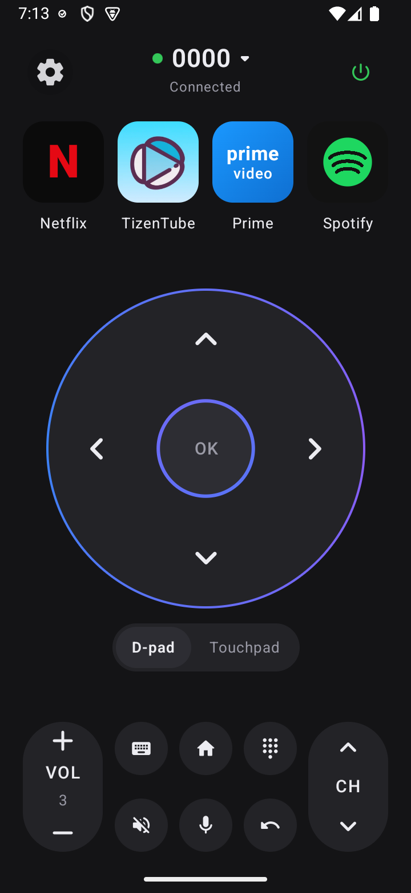
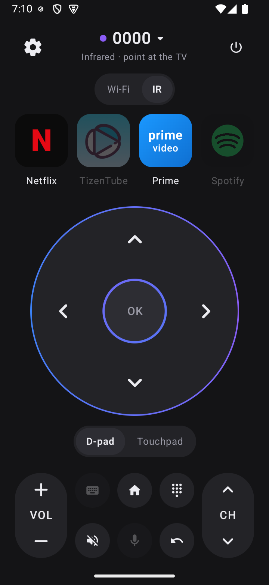
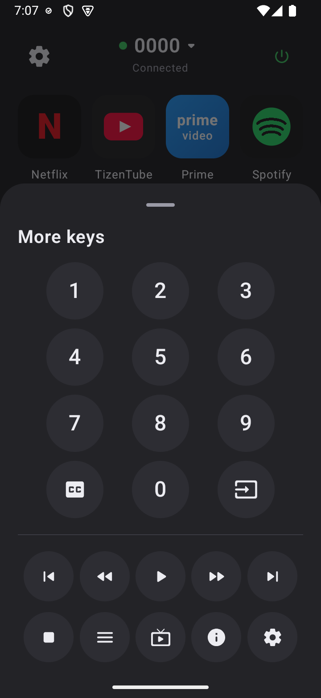
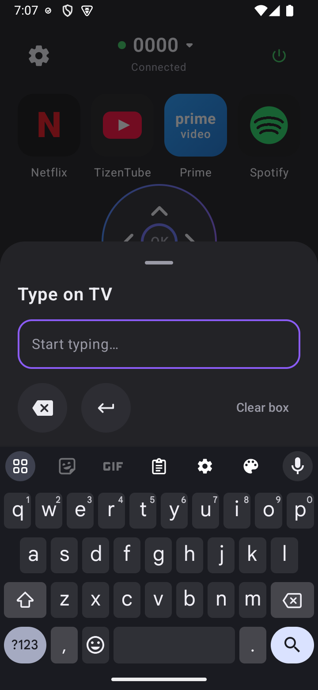

# TV Remote

A fast, lightweight Android remote for Google TV / Android TV, built for a TCL Google TV and a Xiaomi phone. It works two ways:

- **Wi-Fi**: the **Android TV Remote protocol v2**, the same one Google's own remote app uses. TLS on port 6467 for pairing and port 6466 for commands. No ADB, no developer options, no cloud, no ads.
- **Infrared**: through the phone's IR blaster, using TCL's own IR codes. It works with no network and can switch the TV on from deep standby.

The whole app is about 1.5 MB.

<p>
  
  
  
  
</p>

## Download

**[Download TVRemote.apk](https://github.com/sudomastery/tv-remote/releases/latest/download/TVRemote.apk)** (Android 8.0 or newer), or browse all [releases](https://github.com/sudomastery/tv-remote/releases).

To install it, open the APK on your phone and allow installs from that source when asked. Xiaomi phones (HyperOS / MIUI) may run a security scan first.

## Features

| | Wi-Fi | IR |
|---|---|---|
| D-pad with hold-to-repeat, OK long-press | yes | yes |
| Volume / channel rockers, mute, home, back, power | yes | yes |
| Hold power for the TV's "Power off" (full shut down) dialog | yes | yes, untested |
| Back, arrows and OK in the notification shade | yes | yes |
| Advanced: close apps, free RAM, restart TV | yes (needs ADB) | no |
| Number pad, media keys, input, guide, info, captions | yes | yes |
| Live volume level and power state | yes | no |
| Type into TV text fields from the phone keyboard | yes | no |
| Hold-to-talk voice search | yes | no |
| App shortcuts: Netflix, TizenTube, Prime Video, Spotify | all four | Netflix, Prime Video |

**Power when the TV is off the network.** A TCL in deep standby switches its Wi-Fi off, so it can only be turned on with infrared. When Wi-Fi can't reach the TV, a power tap goes out over IR automatically (as a quick two-frame press, like the physical remote) and the power button shows a small **IR** badge so you know. This applies to power only: every other button needs the TV on, at which point it's back on Wi-Fi and the app reconnects by itself. The same happens if the connection looks open but the TV has gone quiet (it normally pings every 5 seconds), so a TV that has just been switched off isn't sent a power press it can't hear.

### Power button

- **Tap**: sleep or wake, like a normal press.
- **Hold**: opens the TV's "Power off: Do you want to shut down?" dialog for a full shut down. Also available as **Shut down TV…** in the More keys sheet.

The app holds the key for a fixed time once a long-press is detected, however quickly you let go: 2 seconds over Wi-Fi, and about 1.9 seconds over IR (the power frame repeated back to back in a single transmission, just under Android's 2 second IR limit). On the TCL a 1.5 s hold opens the dialog, while 0.8 s counts as a normal press and puts the TV to sleep, so a short hold is not safe. While the hold runs, extra power taps and switching TV or mode are ignored for the same reason.

In Wi-Fi mode the power off menu needs a live connection. It doesn't fall back to IR like a power tap does, because a TV that Wi-Fi can't reach is usually already off, and holding power over IR would switch it on.

### Notification shade controls

Turn on **Settings > Controls in notification shade** to get back, the arrows and OK in a notification, so you can steer the TV without leaving the app you're in. Collapsed, it's one row of buttons; expanded, it's a D-pad. It shows on the lock screen too.

A small foreground service keeps the notification alive. To save battery, the Wi-Fi link to the TV stays open for 2 minutes after the last tap and then closes. The next tap reconnects (about half a second on a home network) and the key is still delivered, in order, once connected. In IR mode the buttons send infrared directly.

Swiping the notification away hides it until the app is opened again; the setting turns it off for good.

### Advanced tab

Next to the D-pad there is an **Advanced** tab for things the remote protocol can't do. It talks to the TV over network ADB (port 5555):

- **Close this app**: force-stops the app on screen and returns to the launcher.
- **Close other apps**: keeps the app on screen, closes everything else and drops cached background processes. Useful before starting something heavy on a TV with 1 GB of RAM.
- **Close all apps**: the same, including the app on screen.
- **Restart TV**: full reboot, after a confirmation.
- A bar showing the TV's free memory, updated after each action.

Only user-facing apps that are actually running are closed. The launcher, the keyboard and TCL, Android and Google system components are never touched.

Setup: on the TV, enable **Settings > System > Developer options > Network debugging** (tap "Android TV OS build" seven times under About to reveal Developer options). The first time you use the tab, the TV asks to allow debugging from the phone: choose **Always allow**.

### App shortcuts

Apps are opened with deep links that each app registers for itself, not `market://launch` links. On this TV the Play Store can't resolve `market://launch`, and the TV's remote service drops the connection when a launch fails.

| Button | Package | Link |
|---|---|---|
| Netflix | `com.netflix.ninja` | `https://www.netflix.com/browse` |
| TizenTube | `io.gh.reisxd.tizentube.cobalt` | `https://www.youtube.com` |
| Prime Video | `com.amazon.amazonvideo.livingroom` | `https://app.primevideo.com` |
| Spotify | `com.spotify.tv.android` | `spotify://` |

The TizenTube button relies on stock YouTube (`com.google.android.youtube.tv`) being uninstalled from the TV. TizenTube is then the only app that handles `youtube.com` links. If stock YouTube is installed, the TV may open it instead. In IR mode the TizenTube button is disabled, because the remote's YouTube IR button targets stock YouTube.

## Project layout

| Module | What it is |
|---|---|
| `atvremote/` | Pure Kotlin/JVM library for the Android TV Remote v2 protocol: pairing, the command channel, a self-signed client certificate (no BouncyCastle), and pinning of the TV certificate. Also `TvAdb`, app management over ADB |
| `app/` | Jetpack Compose app: UI, mDNS discovery, voice capture, IR transmitter |

### IR codes

`app/src/main/kotlin/.../ir/TclIr.kt` holds the TCL keymap read from the TV itself (`/vendor/tvconfig/config/ir_config.ini`, protocol `0x07`, address `0xF`). Other TCL TVs that use the same RCA-style remote should work too. It is sent with the **RCA-38** timings that IRDB lists for TCL TVs (38 kHz carrier, 460 µs unit). Unit tests check the bits against two independent sources: Flipper-IRDB captures of real TCL remotes, and IRDB's TCL code list (26 keys match).

## Build

Requires JDK 21 and the Android SDK (`local.properties` with `sdk.dir`).

```sh
./gradlew :app:assembleRelease      # build/dist/TVRemote.apk
./gradlew test                      # library and IR encoder tests
```

Release builds are signed with the local debug keystore for sideloading.

### Testing the protocol from a desktop

`atvremote` ships a small CLI for checking things against a real TV without a phone:

```sh
./gradlew -q :atvremote:cli --args="<tv-ip> pair"         # then type the code shown on the TV
./gradlew -q :atvremote:cli --args="<tv-ip> info"
./gradlew -q :atvremote:cli --args="<tv-ip> key DPAD_DOWN DPAD_UP"
./gradlew -q :atvremote:cli --args="<tv-ip> app spotify://"
./gradlew -q :atvremote:cli --args="<tv-ip> adb memory"         # also close-current, close-others, close-all
```

The CLI keeps its identity in `.atv/` (git-ignored).

### Testing the app without a TV

`atvremote` also has a fake TV that pairs with the app and logs every key, app launch and text it receives:

```sh
./gradlew -q :atvremote:fakeTv
```

In the Android emulator, pair with the IP address `10.0.2.2` (the host PC) and type the code the fake TV prints.

## First run

1. Phone and TV on the same Wi-Fi. The TV shows up automatically (mDNS `_androidtvremote2._tcp`), or you can type its IP address.
2. Tap it, and enter the 6-character code the TV shows.
3. If the phone has an IR blaster, a **Wi-Fi / IR** switch appears under the TV name.

If the TV stops accepting the phone (for example after a factory reset), use **Settings > Pair this TV again**.

## Branches

- `main`: released versions, tagged
- `develop`: integration branch; feature branches (`feature/*`) merge here

## Credits

Protocol definitions (`polo.proto`, `remotemessage.proto`) and protocol behaviour come from [tronikos/androidtvremote2](https://github.com/tronikos/androidtvremote2) (Apache-2.0, license included next to the proto files), which builds on Google's pairing protocol and [louis49/androidtv-remote](https://github.com/louis49/androidtv-remote). The TizenTube button uses TizenTube's own launcher icon, from [reisxd/TizenTube](https://github.com/reisxd/TizenTube) (GPL-3.0, see `third_party/tizentube-icon/`). ADB support uses [dadb](https://github.com/mobile-dev-inc/dadb) (Apache-2.0). IR timings come from [Flipper Zero firmware](https://github.com/flipperdevices/flipperzero-firmware), reference captures from [Flipper-IRDB](https://github.com/Lucaslhm/Flipper-IRDB), and the RCA-38 definition and TCL code list from [IRDB](https://github.com/probonopd/irdb).
